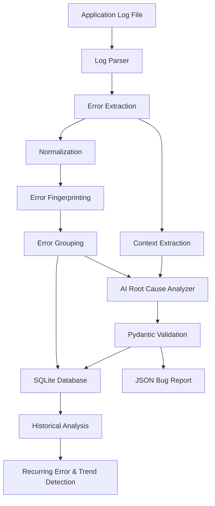

# Bug Finder
### AI-Powered Log Intelligence & Root Cause Analysis System

Bug Finder is an AI-powered log analysis system that identifies recurring application errors, groups similar incidents, extracts relevant log context, and uses an LLM to generate structured root cause analysis with supporting evidence and suggested fixes.

The system also maintains historical scan records and detects recurring errors and changes in their occurrence frequency across scans.

## Key Features

- **Log Parsing:** Extracts ERROR, CRITICAL and FATAL messages from application logs.
- **Context Extraction:** Captures surrounding log lines to preserve information useful for debugging.
- **Error Normalization:** Normalizes dynamic values such as timestamps, UUIDs, IP addresses and entity IDs.
- **Error Fingerprinting:** Generates stable SHA-256 fingerprints to identify similar errors.
- **Error Grouping:** Groups similar errors and tracks frequency, severity and timestamps.
- **AI Root Cause Analysis:** Uses Groq LLM inference to identify likely causes and recommend corrective actions.
- **Structured AI Output:** Validates analysis using Pydantic models.
- **Evidence-Based Analysis:** Includes relevant log messages supporting the generated diagnosis.
- **Historical Tracking:** Stores scan runs and error groups in SQLite.
- **Recurring Error Detection:** Identifies errors occurring across multiple scans.
- **Trend Analysis:** Compares the latest two scans to identify increasing, decreasing, stable or resolved error patterns.
- **JSON Reports:** Generates a structured report for every scan.

## Architecture



## Technology Stack

| Component | Technology |
|---|---|
| Programming Language | Python |
| LLM Inference | Groq |
| AI Model | openai/gpt-oss-120b |
| Data Validation | Pydantic |
| Database | SQLite |
| Log Processing | Python Regex |
| Fingerprinting | SHA-256 |
| Testing | Pytest |
| Configuration | python-dotenv |

## Project Structure

```text
Bug_Finder/
├── src/
│   ├── log_parser.py
│   ├── schemas.py
│   ├── analyzer.py
│   ├── database.py
│   └── main.py
├── tests/
│   ├── test_log_parser.py
│   └── test_database.py
├── sample_logs/
│   └── application.log
├── .env
├── .gitignore
├── requirements.txt
└── README.md
```

## Setup and Installation

### 1. Clone the repository

```bash
git clone <YOUR_GITHUB_REPOSITORY_URL>
cd Bug_Finder
```

### 2. Create a virtual environment

```bash
python -m venv .venv
```

Activate it on Windows:

```powershell
.venv\Scripts\Activate.ps1
```

### 3. Install dependencies

```bash
pip install -r requirements.txt
```

### 4. Configure environment variables

Create a `.env` file in the project root:

```env
GROQ_API_KEY=your_groq_api_key
```

Never commit your actual API key.

## Running the Application

Run Bug Finder using:

```bash
python -m src.main sample_logs/application.log
```

The system will:

1. Read the supplied log file.
2. Extract and group errors.
3. Identify relevant log context.
4. Generate AI-based root cause analysis.
5. Store scan information in SQLite.
6. Generate a JSON bug report.

## Output

The application generates:

- `bug_finder.db` — historical scan and error records.
- `sample_logs/application_bug_report.json` — structured analysis report.

The report includes:

- Scan ID and source file
- Unique error group count
- Total error occurrences
- AI analysis status
- Error severity and frequency
- Likely root cause
- Supporting evidence
- Suggested fixes
- Confidence score

## Historical Analysis

Bug Finder tracks recurring errors using stable fingerprints.

It compares the latest two recorded scans to classify occurrence trends:

| Condition | Trend |
|---|---|
| Latest count > Previous count | INCREASING |
| Latest count < Previous count | DECREASING |
| Both counts equal | STABLE |
| Previously present, now absent | RESOLVED |

Only errors found in more than one scan are returned as recurring errors.

## Running Tests

Run the complete test suite:

```bash
python -m pytest -v
```

The tests validate log processing, error grouping, database persistence, recurring error detection and trend classification.

## Engineering Considerations

- Dynamic log values are normalized before fingerprint generation to reduce duplicate error groups.
- Severity is considered separately from the error fingerprint.
- Log contents are treated as untrusted input in the AI analysis prompt.
- Pydantic validates the structure and constraints of AI-generated output.
- Parameterized SQL queries are used for database operations.
- AI analysis failures are recorded without discarding the corresponding error group.
- Database history is maintained independently of generated JSON reports.

## Current Limitations

- Supports the configured log format and severity patterns; arbitrary log formats may require parser adaptation.
- Root cause analysis is LLM-generated and should be reviewed before applying suggested fixes.
- Trend analysis compares the latest two recorded scans, not a time-series forecasting model.
- A RESOLVED classification means an error was absent from the latest scan; it does not prove permanent resolution.
- Requires a valid Groq API key and network access for AI analysis.

## Future Scope

Potential extensions include support for additional log formats, observability platform integrations and automated incident workflows.

## Author

Developed as a practical AI/ML and Generative AI engineering project.
